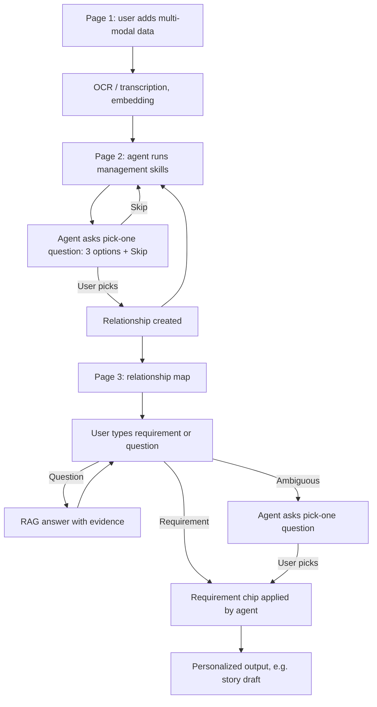

# Legacy Box — UI/UX Interface Requirements

**Project:** Legacy Box — Personal Memory Agent  
**Responsibility:** UI/UX Interface  
**Document type:** Requirements extracted from handwritten notes, revised with team clarifications  
**Version:** v2 (2026-11-05) — supersedes the v1 draft's screen roles  
**Status:** Draft; some abbreviations still need team confirmation (see §9)

## 1. Overview

Legacy Box is a personal memory agent. The user supplies multi-modal material; an agent built on our embedding model and a Small Language Model (SLM) does most of the organizing work through its *agent management skills*; users who want a more personal result can then shape it directly.

The interface has three pages, each with a distinct role:

| Page | Role | Who it is for |
|---|---|---|
| **1. My Memories** (Capture) | **User data / input field.** Where raw multi-modal material goes in. | Everyone |
| **2. Agent** (Ask / Connect) | **Agent interface.** The agent runs its skills on the data and asks the user simple pick-one questions. Answers create relationships. | Everyone; low effort |
| **3. Make It Personal** (Q&A / RAG) | **Personalization main page.** Shows the relationships built from the user's answers and lets the user type specific requirements. Q&A and RAG are tools on this page, not the whole page. | Users who want a personal result |

### Key clarifications (v2)

1. **Most work is done by the agent.** Organizing, tagging, linking and summarizing happen through agent management skills on page 2. The user is not expected to configure anything.
2. **Q&A exists for personalization.** The agent's automatic result is good enough for most users. The Q&A field on page 3 is an interaction interface where a user who wants a more personal result can state *specific requirements* (audience, tone, naming, privacy, focus) or ask questions about their memories.
3. **Relationships are not created at capture time.** When people upload photos, voice notes or documents, no relationships are entered. Relationships are generated **while the user interacts with the agent on page 2**.
4. **The agent asks pick-one questions.** To generate relationships, the agent asks short multiple-choice questions, typically **3 options, pick one** (plus Skip). Simple is better: the user should not need to think hard or type.
5. **Page 3 is the main page for personal users.** It is where the relationship map, the user's requirements, and agent answers come together.
6. **Back end:** teammates will connect the UI to our embedding model (vector search over memories) and the SLM (agent questions, interpretation of requirements, answers). The UI must keep this behind one adapter so the mock can be replaced without touching screens (see §7).

## 2. Requirements extracted from the sketch (v1, unchanged)

| Stage | Original notation | UI/UX interpretation | Status |
|---|---|---|---|
| 1 | `Capture` | Entry point for adding personal memory materials. | Now "My Memories", the user data page. |
| 1 | `A, V, I, L` (handwriting unclear) | Multiple capture/input categories. | Still unconfirmed; demo uses Photo, Voice, Note, Document as placeholders. |
| 1 | `OCR` (with arrows) | OCR is part of capture/preprocessing. | Runs automatically on upload in the demo; unconfirmed. |
| 1 | `agent` | An agent processes captured information. | Confirmed: agent management skills, shown on page 2. |
| 2 | `Ask` | User question/input interface. | Revised: the *agent* asks the user pick-one questions. |
| 2 | `C` | Additional item written after Ask. | Still unconfirmed. |
| 2 | `Connect (Optional)` | Optional relationship exploration. | Confirmed: relationships come from answers to agent questions. |
| 3 | `Q&A` | Question-and-answer interface. | Revised: requirement + question input for personalization. |
| 3 | `RAG` | Retrieval-augmented responses. | Confirmed: embedding search over memories; evidence shown with every answer. |
| 3 | Sketched result panel | Header, content/image regions, linked items, bottom input. | Kept; linked items = relationship map. |

## 3. Screen structure

### Page 1 — My Memories (user data / input field)

**Goal:** Get the user's material into the box with as little effort as possible.

**v4 interface:** the start page shows only a **Lore** button (enters the app) and one input box: type and press Enter, or press the microphone to talk, or use the paperclip or drop files anywhere. No menu or header on the start page. The Questions page shows one question at a time; the People & stories page shows the map and a conversation. Everything else is folded behind one link on each page.

**Agent depth (v4):** after reading each item, the agent writes notes on it: what happened, who (with evidence), when, where, why it matters, links to earlier memories (backed by shared people, year, words and vector similarity), and what is still unclear. These notes feed the follow-up question and are shown under "How I worked this out" on each question card.

**v3 interface:** the page shows one large button. Press once to talk, press again to finish. The recording goes through the same pipeline as any other item, then the agent replies out loud with one short follow-up question. Everything below still works: files and folders can be dropped anywhere on the page, and the other controls sit behind one link under the button. Automatic upload is a future goal.

- Input types for multi-modal data (photo/scan, voice recording, written note, letter/document; final categories pending A·V·I·L).
- Typed note field for quick text memories.
- **Agent naming:** files with camera, phone or app names (IMG_…, DSC…, WhatsApp…, hashes, mostly digits) get a 2–6 word name from their content. Clear names are kept, and the original name is shown.
- **Detailed reading:** for each picture or video frame the agent records the event, setting, main person, other people, objects and mood, and writes a specific 2–3 sentence account. This is what relationship questions are built on, for example "Who is the main person in 'Grandma's 80th birthday'?"
- Per-item status: stored → text read (OCR) or transcribed → embedded → handed to agent.
- The collection of everything saved, with type, date and people *as read from the material*.
- **No relationship entry here.** No forms asking "who is this person to you".
- **Own files:** users can drag in, or choose, files or a whole folder from their computer (photos, videos, audio, text and documents; up to 30 per batch in the prototype).

#### Trying the prototype with local files

In demo mode the files never leave the browser. What the browser can read for real:

| File type | Read in the browser | Left to the team's models |
|---|---|---|
| Photo | Thumbnail, size in pixels, camera date (EXIF), year in file name | What is in the picture, writing on it (OCR) |
| Video | Thumbnail frame, length, resolution, playback | What is shown and said |
| Audio | Length, real waveform, playback | Transcript, speakers |
| Text (.txt, .md, .csv, .srt, .vtt) | Full text, known names, years mentioned | Deeper meaning, summary |
| PDF / Word | Name and date only | Text extraction / OCR |

Anything not read is shown as *not sure* in the agent's understanding. The agent then asks pick-one questions built from what it did read: who is in it (options from people already in the box), when it is from (file-name year vs. file-saved year vs. earlier decades), and which story it belongs to (existing story groups and the most similar memory by embedding). With `CONFIG.apiBase` set, the file itself is sent to `POST /memories` and the server's observations replace the browser-only ones.

### Page 2 — Agent (agent interface)

**Goal:** Let the agent do the work, and let the user steer it with a few taps.

- **Model status:** whether the embedding model and SLM are connected, or the UI is in demo mode.
- **Agent skills panel:** the management skills the agent runs (e.g. Read & transcribe, Find people, Group into stories, Spot unclear details) and what each one did, as an activity log.
- **Questions come from the agent's simple understanding of the user's data.** For each item the agent forms a short, modality-specific understanding:
  - Photo: what it sees, and the writing on the photo (OCR).
  - Voice: what it heard (transcript), names, places, feeling.
  - Document: what it looks like, and what it read (OCR).
  - Note: what the user wrote, and the names in it.
  Each observation is marked *sure*, *my guess*, or *not sure*. The agent asks only about what it cannot settle on its own: an unclear word, a person's role, whether two items are one story.
- **Pick-one question card** (primary element):
  - Top: **"What I understood"**, with the item thumbnail(s) and the agent's observations, plus one sentence on why it is asking ("I found the name 'Helen' on your recipe card, but nothing says how Helen is related to you").
  - Then one question at a time.
  - Exactly **3 options + Skip**, large buttons, one tap to answer.
  - A progress count ("Question 2 of 6").
  - After each answer, a short confirmation of what was learned ("Saved: Walter is your husband").
- Every answer becomes a **relationship** (see §5) and is visible on page 3.
- Link to page 3 once the user has answered at least one question.

### Page 3 — Make It Personal (personalization main page)

**Goal:** Give users who want a personal result one place to see what the agent has learned and tell it exactly what they want.

Regions, following the hand-drawn panel:

1. **Top region:** page header with a summary of what the agent has learned (counts of relationships and requirements).
2. **Relationship region (main):** a map of people, memories and themes built **only** from the user's answers on page 2. Each link shows which answer created it, and can be removed.
   - **The map is an editable canvas.** Users can drag any node, pan and zoom, and draw a new link by dragging a node's + handle onto another node. Each drawn link asks a short pick-one for its meaning. Users can click a line to remove it and add new person or theme nodes.
   - **Agent arrangement.** "Arrange for me" clusters memories using the user's answers and embedding similarity (`POST /similarity`), and places people beside the memories they belong to. "Tidy columns" gives a plain people / you / memories layout. Hand-drawn links count as relationships, marked as drawn by the user.
3. **Interaction region (Q&A):** a conversation with the agent where the user types:
   - **Requirements** — e.g. "Write the lake stories for my grandkids in simple words", "Call Walter Grandpa", "Keep the Army papers private". The agent turns each into a visible, removable *requirement chip* (Audience, Tone, Naming, Privacy, Focus).
   - **Questions** — e.g. "Where did we spend summers?" Answered with RAG: retrieved memories shown as evidence, separate from the AI-written text.
   - When a request is ambiguous, the agent answers with another **pick-one question** instead of asking the user to type more.
4. **Visual region:** thumbnails of the memories used in the latest answer.
5. **Bottom region:** the input field.

## 4. User flow

## 5. Relationship model

A relationship is created only by a user's answer to an agent question.

| Field | Meaning |
|---|---|
| `from`, `to` | Person, memory, or theme ids |
| `type` | `role` (person → owner), `same_story` (memory ↔ memory), `theme` (memory → theme), `identity` (unclear text → person), `priority` (memory flagged as important) |
| `label` | Human-readable, e.g. "husband", "same story" |
| `source` | Question id and chosen option, so page 3 can say "from your answer to: Who is Walter to you?" |
| `created_at` | Timestamp |

Pick-one question rules:

- Every question is grounded in the agent's understanding of specific items and shows that understanding first, so the user sees why the agent is asking.
- 3 options, mutually exclusive, written in everyday words; always a **Skip / Not sure** escape.
- Options are generated by the SLM from the user's own data (names, places, dates found in the material).
- Never ask more than one thing per question. Never require typing.
- Questions that resolve unclear OCR (e.g. "baby J?") come first, since they affect later answers.

## 6. UI/UX priorities

- **Clear roles:** data in (1), agent works (2), personal control (3) must be immediately distinguishable.
- **Low interaction burden:** taps over typing; the agent proposes, the user picks.
- **Optional depth:** a user can stop after page 2; page 3 is for those who want more.
- **Visible memory context:** show the photos and records behind every answer and every relationship.
- **Color for the real audience:** older adults use the product and their adult children usually set it up and buy it. The main surfaces and page accents are warm. Colors come from family prints and albums (brick red, amber, wine), with olive and lake teal only as small accents. Text meets at least 7:1 contrast, warm hues carry the main actions because aging eyes separate blues and violets less well, and meaning is never shown by color alone (shape, letter or label always goes with it).
- **Trust:** distinguish saved records from AI-written text; show where each relationship came from; never present a guess as a fact.
- **Accessibility:** large readable text, large controls (≥ 48 px), simple navigation; suitable for older adults and for TV use.

## 7. Back-end integration (embedding model + SLM)

The UI calls the back end through one adapter object (`LegacyAPI` in `legacy-box-demo.html`). In demo mode it uses in-page mocks; setting `CONFIG.apiBase` switches it to HTTP. Proposed endpoints:

| Call | Endpoint | Request | Response |
|---|---|---|---|
| Ingest a memory | `POST /memories` | multipart: `file` (photo, video, audio, document) + `meta` JSON `{kind, title, year, people}`; or JSON `{kind, title, text, year, people}` for typed notes | `{id, text, year?, people?, observations: [{label, value, confidence}]}` (OCR / transcript / vision description filled in; `observations` is the agent's understanding shown on page 2) |
| Embed text | `POST /embed` | `{texts: string[]}` | `{vectors: number[][]}` |
| Semantic search | `POST /search` | `{query, k}` | `{hits: [{memoryId, score}]}` |
| Run agent skills | `POST /agent/run` | `{memoryIds}` | `{log: [{skill, message}], questions: [Question]}` |
| Answer a question | `POST /agent/answer` | `{questionId, optionId}` | `{relationships: [Relationship], message}` |
| Write an answer or story (page 3) | `POST /interact` | `{mode: "answer" \| "story", text, memoryIds, length?, owner, requirements, relationships}` — `memoryIds` are the memories already retrieved by `/search`; `relationships` are plain sentences ("Walter is your husband") | `{answer: {text}}` or `{story: {title, paragraphs, memoryIds}}` |
| Health | `GET /health` | — | `{ok, device, models: {embedding, speech, vision_slm: {name, status}}}` |

In the reference server (`server/`, see its README), requests on page 3 (audience, tone, naming, privacy, length) are recognized in the page, and pick-one follow-ups are asked there too. The server's language model only writes the final answer or story from the retrieved memories. A future version may move request recognition to the server with the response shape below.

| (future) Interact | `POST /interact` | `{text, relationships, requirements}` | `{text, requirements?: [Requirement], answer?: {text, evidence:[{memoryId, score}]}, story?: {title, paragraphs, memoryIds}, choice?: Question}` |

`Question` = `{id, text, basis, memoryIds, understanding: [{memoryId, observations: [{label, value, confidence: "sure" | "guess" | "unclear"}]}], options: [{id, label, relationship?, requirement?}] (exactly 3)}`. `basis` is the one sentence explaining why the agent is asking. On page 2 an option carries a `relationship`; on page 3 it may carry a `requirement` instead.  
`Requirement` = `{kind: "Audience" | "Tone" | "Naming" | "Privacy" | "Focus" | "Length" | "Note", text, value}`.

Note: the published artifact cannot call outside servers. To test against the real back end, open the HTML file from the team's own server or locally with `CONFIG.apiBase` set.

## 8. Deliverables

| Deliverable | Scope | Priority | Status |
|---|---|---|---|
| Clickable prototype | All three pages with sample data and mock agent | P0 | Done (`legacy-box-demo.html`) |
| Pick-one question component | Card, 3 options + Skip, progress, confirmation | P0 | In prototype |
| Relationship map | Built from answers, with source and remove | P0 | In prototype |
| Requirement chips + Q&A thread | Page 3 interaction region | P0 | In prototype |
| Adapter + endpoint contract | §7 | P0 | Mock done; back end to connect |
| Processing feedback | OCR / embedding / agent states | P1 | In prototype |
| Older-adult accessibility review | Text size, controls, navigation | P1 | Pending |

## 9. Questions still to confirm

1. What exactly do **A, V, I, L** represent on page 1?
2. What does **C** mean after Ask?
3. Is **OCR** run on every eligible upload, or selected manually?
4. Is page 3 input text, voice, or both?
5. Should the first UI run on the Legacy Box TV, a web app, or both?
6. How many pick-one questions should the agent ask per session before pausing?
7. What outputs should personalization produce (story drafts, albums, a family tree, something else)?

Resolved in v2: the meaning of **Connect** (relationships from agent questions), the role of **Q&A** (personal requirements and questions), and the role of the **agent** (management skills on page 2).
